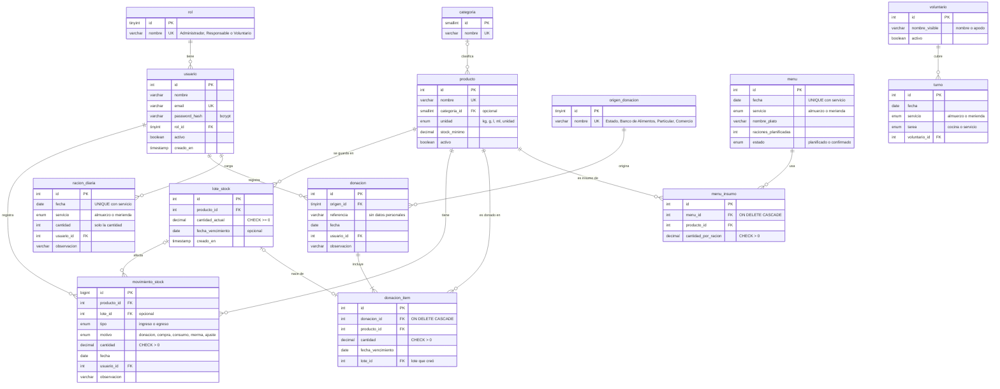

# Diagrama entidad-relación — ComeTUC

Base `cometuc` (MySQL 8). Hecho a partir de [`backend/db/schema.sql`](../backend/db/schema.sql). GitHub dibuja el diagrama automáticamente. También está como imagen, para imprimir o mostrar: [der.png](der.png).

## Reglas de la base

| Regla | Dónde |
|---|---|
| El stock nunca es negativo | `lote_stock.cantidad_actual CHECK (>= 0)`; además, la API responde 409 si no alcanza |
| Cantidades siempre positivas | `CHECK (> 0)` en `movimiento_stock`, `donacion_item` y `menu_insumo` |
| Un menú y una fila de raciones por día y servicio | `UNIQUE (fecha, servicio)` en `menu` y en `racion_diaria` |
| Una persona no se repite en el mismo turno | `UNIQUE (fecha, servicio, tarea, voluntario_id)` en `turno` |
| Al borrar una donación o un menú se borran sus ítems | `ON DELETE CASCADE` en `donacion_item` y `menu_insumo` |
| Correos y nombres de producto únicos | `UNIQUE` en `usuario.email` y `producto.nombre` |
| Sin datos de personas asistidas | No hay tablas de personas asistidas: `racion_diaria` guarda solo cantidades y `voluntario` solo un nombre o apodo |

**Notas**
- `racion_diaria` y `menu` se relacionan por fecha y servicio, no con una FK: las raciones servidas se cargan aunque no haya menú.
